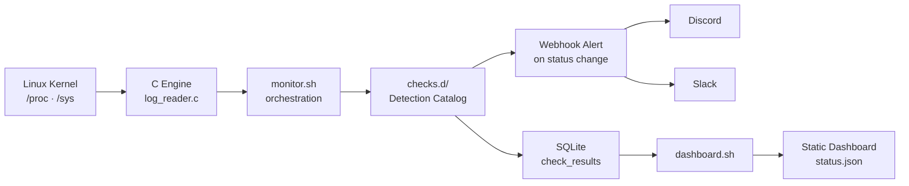
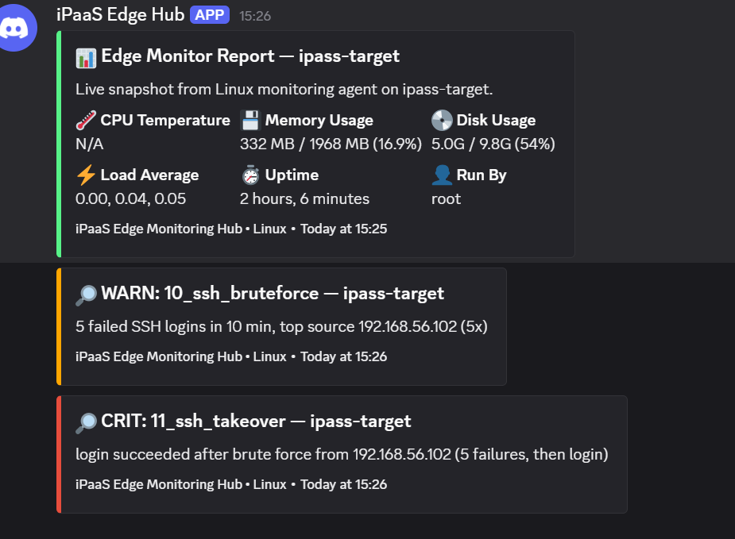
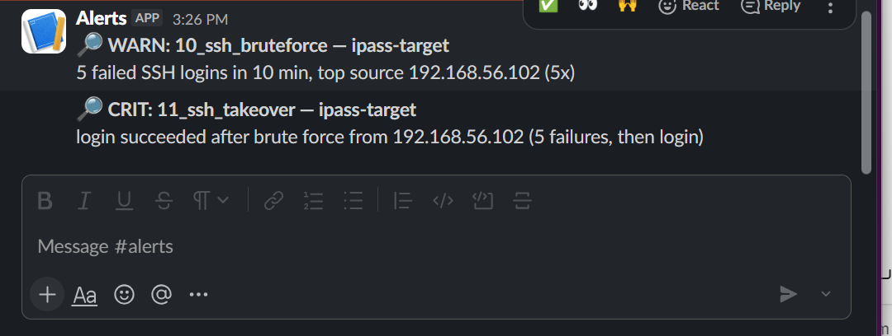
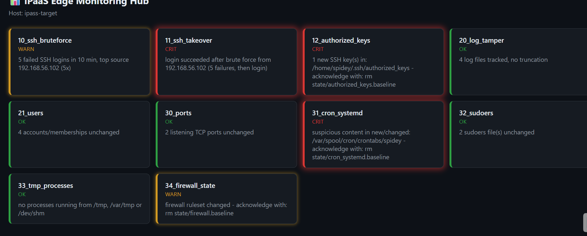

# iPaaS Edge Monitoring Hub


Lightweight Linux security and health monitoring for MSPs and IT Systemhäuser.
Deploys in under ten minutes, alerts to Discord and/or Slack, keeps a
complete audit trail in SQLite, and ships a built-in dashboard — no external
monitoring platform required.

## Demo

[Watch the demo video](#) — a full walkthrough: deployment, live attack
simulations, and the dashboard reacting in real time.

## Motivation

Small MSPs and IT Systemhäuser need reliable Linux server monitoring without
the overhead of enterprise tooling. Nagios and Zabbix require dedicated
infrastructure and days of configuration before they produce a single
alert. This project is a single agent, deployable on any Linux host with a
handful of common packages already present on nearly every distribution.

## Use Cases

**MSPs and IT Systemhäuser** — deploy on client servers for lightweight
real-time monitoring without enterprise tool overhead. One agent per
server, alerts routed directly to your team's existing chat channel.

**Industry 4.0 and edge computing** — monitor distributed Linux nodes at
manufacturing sites and remote locations where resource efficiency matters
and connectivity may be limited.

**Server rooms** — thermal and host-state monitoring with immediate
alerting, reducing the need for constant on-call manual checks.

**Audit-ready environments** — every check, every status, every threshold
event is logged to SQLite with full timestamps, giving a complete,
queryable trail for compliance requirements.

## Architecture



`monitor.sh` runs on a systemd timer, collects host metrics via a small C
engine reading `/proc` and `/sys` directly, executes every check in
`checks.d/` in numeric order, writes every result to SQLite regardless of
outcome, and alerts over webhook only when a check's status changes.

## Detection Catalog

Ten checks currently run on a five-minute interval. Each produces one of
`OK`, `WARN`, `CRIT`, or `ERROR`.

**Access and authentication**
- `10_ssh_bruteforce` — repeated failed SSH logins from a single source
- `11_ssh_takeover` — a successful login immediately following a string of failures
- `12_authorized_keys` — new or modified SSH public keys

**Accounts and evidence**
- `21_users` — new accounts or privilege group membership changes
- `20_log_tamper` — logs shrinking or vanishing without a matching rotation event

**Host state**
- `30_ports` — new listening TCP ports, severity scaled by network reachability
- `31_cron_systemd` — new or changed scheduled tasks, pattern-matched against common persistence techniques (reverse shells, piped downloads, encoded payloads)
- `32_sudoers` — changes to sudoers configuration, with specific detection for passwordless escalation rules
- `33_tmp_processes` — processes executing from world-writable temporary directories
- `34_firewall_state` — firewall service stopped, ruleset modified, or no active firewall found

Each check is a standalone script. Extending the catalog means adding a
numbered file to `checks.d/` — no registration step required.

Full threshold reference: see `config/ipass.conf` and the Configuration
section below.

## Alerting

Alerts are delivered over webhook to Discord and Slack independently —
either, both, or neither can be configured. Notifications fire on status
transition only (`OK → WARN`, `WARN → CRIT`, `CRIT → RECOVERED`), keeping
the channel signal-driven rather than a stream of routine pings.

| Discord | Slack |
|---|---|
|  |  |

## Dashboard

A static dashboard renders live check status and recent host metrics,
regenerated on every monitoring cycle. There is no backend process and
nothing is exposed beyond a plain file server — `status.json` is written to
disk and the page polls it client-side.



**Run it:**
```bash
cd dashboard
python3 -m http.server 8080 --bind 127.0.0.1
```

**Access it securely.** The dashboard has no authentication layer by
design — it is not intended to be reachable from an untrusted network. Bind
it to loopback (as above) and reach it over an SSH tunnel:

```bash
ssh -L 8080:localhost:8080 user@host
```

This reuses existing SSH key-based authentication rather than introducing a
second credential system for a read-only status page.

## Setup

```bash
git clone <repo-url>
cd ipass-edge-hub
./setup.sh
```

`setup.sh` installs required packages (`gcc`, `curl`, `sqlite3`,
`systemctl`, `bc`, `python3`), compiles the C engine, prompts for Discord
and/or Slack webhook URLs, writes default thresholds, and installs the
systemd timer. It is safe to re-run — existing configuration is never
overwritten.

## Configuration

Thresholds are centralized in `config/ipass.conf`:

```ini
TEMP_WARN=80.0
RAM_WARN=85.0
SSH_FAIL_WARN=5
SSH_FAIL_CRIT=20
SSH_TAKEOVER_FAILS=5
```

Webhook endpoints are kept separately in `config/webhook.conf`, which is
excluded from version control:

```ini
DISCORD_WEBHOOK_URL="https://discord.com/api/webhooks/..."
SLACK_WEBHOOK_URL="https://hooks.slack.com/services/..."
```

## Known Limitations

- **Detection is snapshot-based, not event-driven.** Checks compare
  point-in-time state against a stored baseline on each cycle. A sequence
  completed entirely within a single interval — create, escalate, delete —
  can leave no trace by the following run. This is closer to MITRE's
  Indicator Removal (T1070) than a flaw in individual checks; a planned
  off-box collector addresses it.
- **Local state is host-resident.** An attacker with root access on the
  monitored host can modify baselines and logs in place; evidence is not
  currently stored off-box.
- **UDP is not monitored** — only TCP listening ports are tracked.
- **The dashboard has no built-in authentication**, by design. See the
  Dashboard section for the intended access pattern.
- **Full visibility requires root.** Reading other users' authorized keys,
  crontabs, sudoers content, or firewall rules is restricted at the OS
  level; the installed systemd service runs as root.
- **Alerts are transition-based.** A check remains in its alerted state
  until explicitly acknowledged; a second distinct event during an active
  alert does not produce an additional notification.

## Roadmap

**Service side**
- Central collector and fleet dashboard — many hosts reporting to one
  place, evidence kept off-box so a root-level attacker cannot erase it
  locally
- Weekly customer report (PDF/email) summarizing health, incidents, and
  changes per server
- Hardening score per host (Lynis-style: SSH root login, password auth,
  firewall posture, pending updates), shown before and after remediation

**Trust and detection depth**
- Acknowledge-by-command instead of removing baseline files, plus
  maintenance windows that mute alerts during planned work
- File integrity monitoring for `/etc` and system binaries (`dpkg -V`),
  outbound connection monitoring, cryptominer detection, SUID auditing,
  basic port-scan detection
- Health checks: pending updates, failed systemd services, disk inode
  exhaustion
- Each check mapped to MITRE ATT&CK technique IDs in the documentation
- Event-driven triggering (inotify) for SSH and file-integrity checks,
  catching an attempt within seconds rather than up to five minutes —
  complementary to, not a replacement for, the planned off-box collector

**Integrations**
- Additional webhooks: Teams, email, Telegram, generic webhook
- MQTT output for edge and Industry 4.0 deployments
- Prometheus endpoint for Grafana
- Attacker IP reputation enrichment (AbuseIPDB)
- Optional opt-in automated response (fail2ban-style, dry-run first,
  allowlisted, reversible) — alert-only remains the default

**AI and MCP**
- An MCP server over `check_results`, so an assistant can answer "what
  changed on server X this week" and draft incident summaries. Log content
  is treated as untrusted input to any model it's passed to, and nothing
  leaves the host without explicit consent.

## License

See [LICENSE](LICENSE).

## Author

**Yash Kale**
Self-taught developer — C, Bash, Linux, SQLite, systemd, WireGuard

🌐 [Portfolio](https://techcrafter03.github.io/portfolio)
📧 webcrafters071@gmail.com · stacknode.studio@gmail.com
